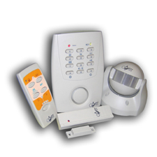

## Coati Alarma

- [Introduccion](01_intro.md)
- [Centralita](02_centralita.md)
- [Detector de Mov.](03_sensorPIR.md)
- [Sensor Magnetico](04_sensorMagnetic.md)
- [Control Remoto](05_remoteControl.md)

The Coati wireless alarm system is designed to protect a home or property against unauthorised entry. It can also operate as an entry chime when the property is occupied.

The system consists of:
- **Central control unit:** Receives signals from wireless sensors and activates the alarm or chime.
- **PIR motion detector:** Detects movement within its field of view.
- **Magnetic contact detector:** Detects the opening of doors and windows.

The central unit supports up to **12 wireless sensor IDs**.

When a registered sensor transmits a radio signal, the central unit responds according to its current operating mode. In alarm mode, it produces a 110 dB audible alarm.

## Central unit keypad commands

| Function | Keypad sequence |
|---|---|
| Instant alarm | `Code + 1` |
| Delayed alarm | `Code + 2` |
| Chime | `Code + 3` |
| Disarm | `Code + 4` |
| Change security code | `Code + 6` |
| Enable keypad tones | `Code + 8` |
| Register sensor | `Code + *` |
| Clear sensor IDs | `Code + #` |

## Sensor registration times

| Device | Initialisation | ID transmission |
|---|---:|---|
| PIR motion detector | 60 seconds | Hold Sabotage SW for more than 3 seconds |
| Magnetic contact detector | 10 seconds | Hold Sabotage SW for more than 3 seconds |

## Important system specifications

| Parameter | Specification |
|---|---|
| Maximum registered sensor IDs | 12 |
| Default security code | 1234 |
| Alarm sound level | 110 dB |
| Sensor learning timeout | 30 seconds |
| Exit countdown | 15 seconds |
| Alarm sounding period | 30 seconds |
| Alarm silent period | 10 seconds |
| Maximum alarm cycles | 10 |
| Keypad input timeout | 10 seconds |
| Keypad lockout after incorrect attempts | 30 seconds |
